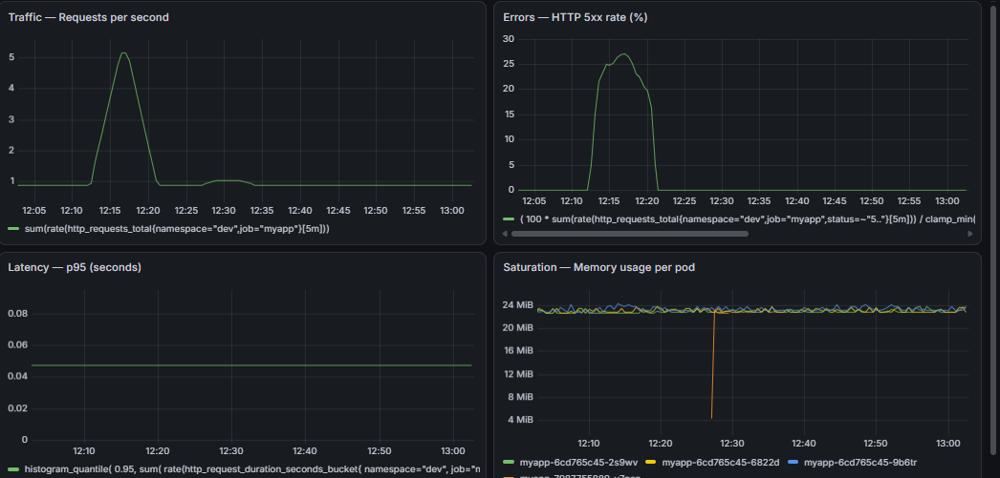

# DevOps Lab 4 — Observability, Alerting and Incident Response

## Part 1 — Instrument the Application

### 1.2 Test endpoints (`/slow` and `/error`)

Evidence: [evidence/lab4/lab4-part1-1.2.txt](../evidence/lab4/lab4-part1-1.2.txt)

### 1.3 Metrics endpoint (`/metrics`)

Evidence: [evidence/lab4/lab4-part1-1.3.txt](../evidence/lab4/lab4-part1-1.3.txt)

### 1.4 Build, tag and push

Local Docker build and run evidence: [evidence/lab4/lab4-part1-1.4.txt](../evidence/lab4/lab4-part1-1.4.txt)

### Q1. Why is it a problem to use a user ID or a full URL containing IDs as a metric label?

Later on in the lab we will need to use Prometheus in order to monitor. A label such as a user ID or a URL like `/users/48291` has an unbounded number of possible values, so each new user or each new ID creates a new series. This is a cardinality explosion.

The consequences are:
- Prometheus memory usage grows with the number of active series, which can lead to the process being killed (OOM).
- Queries become slow and dashboards may time out.
- Disk usage grows for nothing.
- It can be a security hazars (anyone calling random URLs can create series at will and overload prometheus).


### Q2. Why log to stdout in JSON rather than to a file in plain text?

JSON is preferred over plain text because it is structured:
- Each line is one event with named fields (`timestamp`, `level`, `method`, `path`, `status`, `duration_ms`), so log tools can parse it without fragile regular expressions.
- Logs can be filtered and aggregated by field more easily.
- Fields can be correlated with metrics and with other services, and new fields can be added without breaking existing parsers.

The evidence in `lab4-part1-1.2.txt` and `lab4-part1-1.4.txt` shows one JSON line per request written to stdout, both locally and inside the Docker container.


## Part 2 — Deploy the Monitoring Stack

### 2.2 Retrieve the Grafana admin password and log in

Screenshot: [screenshots/lab4/part2/2.2-graphana-connexion.png](../screenshots/lab4/part2/2.2-graphana-connexion.png)

### 2.3 Browse the pre-installed Kubernetes dashboards

Screenshot: [screenshots/lab4/part2/2.3-browse.png](../screenshots/lab4/part2/2.3-browse.png)

### 2.4 Check the Prometheus targets

Screenshot: [screenshots/lab4/part2/2.4-target.png](../screenshots/lab4/part2/2.4-target.png)

Targets in `DOWN` state: [screenshots/lab4/part2/2.4-target-down.png](../screenshots/lab4/part2/2.4-target-down.png)


## Part 3 — Scrape Application Metrics

### 3.1 Create a ServiceMonitor

We created a `ServiceMonitor` resource to allow Prometheus to collect metrics from our Flask application running in the `dev` namespace.

Configuration file: [monitoring/servicemonitor.yaml](../monitoring/servicemonitor.yaml)

The ServiceMonitor selects the Kubernetes Service with the label `app: myapp` and scrapes the `/metrics` endpoint every 15 seconds.

We also configured the Kubernetes Service port with the name `http`, allowing the ServiceMonitor to reference it correctly.

### 3.2 Verify Prometheus Targets

After deploying the ServiceMonitor, we verified the application targets in Prometheus.

Initially, the targets were `DOWN` because the deployed application image did not expose the `/metrics` endpoint.

We updated the Deployment to use the instrumented Docker image:

`ghcr.io/yorgo-haykal/devops-project:f8bac8baba69535cb2af0c55f6527cb1c0d80ab5`

After the rollout, all three application targets were `UP`.

We also verified that Prometheus collected the `http_requests_total` metric from the application.

### Q3. What would you check if your application target was missing from Prometheus?

I would check the following:

1. Verify that the `ServiceMonitor` exists in the correct namespace.
2. Check that its labels match the selectors configured in Prometheus.
3. Verify that the ServiceMonitor selects the correct Kubernetes Service.
4. Check that the Service port name matches the port referenced by the ServiceMonitor.
5. Confirm that the application exposes `/metrics` and that the endpoint is reachable.
6. Check the Prometheus targets page and the Prometheus Operator logs for configuration or discovery errors.

A missing target usually indicates a service discovery or configuration problem, while a `DOWN` target indicates that Prometheus discovered the target but cannot scrape it successfully.


## Part 4 — Build a Grafana Dashboard

### 4.1 Create a Dashboard

We created a Grafana dashboard named **DevOps Lab 4 — Flask Observability** to monitor our Flask application running in Kubernetes.

The dashboard contains four panels based on the Golden Signals:

1. **Traffic — Requests per second:** Measures the rate of incoming HTTP requests using `http_requests_total`.
2. **Errors — HTTP 5xx rate (%):** Calculates the percentage of requests returning HTTP 5xx errors.
3. **Latency — p95 (seconds):** Uses the histogram metric `http_request_duration_seconds_bucket` to estimate the 95th percentile of request duration.
4. **Saturation — Memory usage per pod:** Displays the memory used by each application pod using `container_memory_working_set_bytes`.

These panels help us understand the application's traffic, reliability, response time and resource consumption.

### 4.2 Export the Dashboard

We exported the complete Grafana dashboard configuration as JSON.

Dashboard file: [monitoring/dashboards/flask-observability.json](../monitoring/dashboards/flask-observability.json)

The exported file was validated using:

```powershell
python -m json.tool monitoring/dashboards/flask-observability.json
```

The command completed without errors, confirming that the JSON is syntactically valid.

### Q4. Why is p95 latency more useful than average latency for detecting performance problems?

Average latency can hide slow requests because very fast responses compensate for unusually slow ones.

The p95 latency represents the response time below which approximately 95% of requests fall. It helps identify performance degradation affecting the slowest 5% of requests, which may not be visible in the average.

For example, if most requests complete in 50 ms but some take 2 seconds, the average may still look acceptable while p95 reveals that a portion of users is experiencing slow responses.

Monitoring p95 therefore provides a better view of tail latency and user experience than relying only on the average.

### Evidence

The Grafana dashboard displays the four Golden Signals:
traffic, errors, latency, and saturation.

The screenshot below was captured during the simulated incident,
showing a significant increase in HTTP 5xx errors.




## Part 5 — Alerting

### 5.1 Create a Prometheus Alerting Rule

We created a `PrometheusRule` named `myapp-alerts` to monitor the HTTP error rate of our Flask application.

Configuration file: [monitoring/prometheusrule.yaml](../monitoring/prometheusrule.yaml)

The alert is named **HighErrorRate** and uses the following conditions:

- **Threshold:** More than 10% of HTTP requests return status codes in the 5xx range.
- **Evaluation window:** 2 minutes.
- **Duration:** The threshold must remain exceeded for 2 minutes.
- **Severity:** `critical`.

The rule uses the `http_requests_total` counter to calculate the ratio of HTTP 5xx responses to all HTTP responses.

### 5.2 Deploy and Verify the Alert

We deployed the rule using:

```bash
kubectl apply -f monitoring/prometheusrule.yaml
```

We then verified that Prometheus recognized the `HighErrorRate` alert.

Initially, the alert was in the `Inactive` state because the HTTP error rate was below the configured threshold.

### 5.3 Simulate a High Error Rate

We used Kubernetes port-forwarding to access the application:

```bash
kubectl port-forward -n dev svc/myapp 5001:80
```

We generated repeated requests to the `/error` endpoint for approximately four minutes.

The observed HTTP 5xx error rate reached approximately **29.43%**, exceeding the configured 10% threshold.

Prometheus displayed the following alert transitions:

1. **Inactive:** The error rate was below the threshold.
2. **Pending:** The error rate exceeded 10%, but the required duration had not elapsed.
3. **Firing:** The error rate remained above 10% for at least two minutes.
4. **Inactive:** The alert returned to normal after the error-generating traffic stopped.

Evidence:

- [Alert Pending](../screenshots/lab4/part5/5.8-alert-pending.png)
- [Alert Firing](../screenshots/lab4/part5/5.8-alert-firing.png)

### 5.4 Create an Incident Runbook

We created a runbook describing the operational steps to follow when the `HighErrorRate` alert fires.

Runbook: [docs/runbook.md](../docs/runbook.md)

The runbook covers:

- Identifying the alert in Prometheus.
- Inspecting the Grafana dashboard.
- Checking Kubernetes pods and deployments.
- Investigating application logs.
- Rolling back a faulty deployment when appropriate.
- Verifying recovery and documenting the incident.

We also added a link to the runbook in the alert annotations.

### Q5. What is alert fatigue, and how can it be reduced?

Alert fatigue occurs when engineers receive too many alerts, especially alerts that are repetitive, noisy or not actionable.

Over time, engineers may become desensitized to notifications, making it easier to miss important incidents.

Alert fatigue can be reduced by:

1. **Using appropriate thresholds:** Trigger alerts only when a meaningful condition is detected.
2. **Adding a `for` duration:** Require the problem to persist before firing an alert.
3. **Avoiding duplicate alerts:** Group related notifications and suppress redundant ones.
4. **Using severity levels:** Distinguish critical incidents from lower-priority warnings.
5. **Providing runbooks:** Ensure that alerts contain actionable information and clear response procedures.

An effective alerting system should notify engineers about problems that require action rather than every temporary fluctuation.


## Part 6 — Incident Response

### 6.1 Simulate a Faulty Deployment

We simulated a faulty deployment in our local Kubernetes cluster by intentionally changing the application's readiness probe endpoint from `/health` to `/health-broken`.

The new endpoint did not exist in the Flask application and returned HTTP 404.

After applying the modification, Kubernetes created a new pod, but it remained in the `0/1 Ready` state.

The three existing healthy pods remained available during the rolling update.

### 6.2 Detect and Diagnose the Incident

We inspected the Kubernetes deployment using:

```bash
kubectl get pods -n dev
kubectl rollout status deployment/myapp -n dev --timeout=15s
kubectl describe pod myapp-7987755889-v7gcn -n dev
```

The rollout did not complete successfully.

The Kubernetes events showed:

```text
Warning  Unhealthy  Readiness probe failed: HTTP probe failed with statuscode: 404
```

This confirmed that the incident was caused by an incorrect readiness probe configuration rather than an application startup failure.

### 6.3 Mitigate the Incident

Before simulating the incident, we identified revision `10` as the last known healthy deployment.

The healthy revision used the Docker image:

`ghcr.io/yorgo-haykal/devops-project:f8bac8baba69535cb2af0c55f6527cb1c0d80ab5`

We restored the healthy deployment using:

```bash
kubectl rollout undo deployment/myapp -n dev --to-revision=10
```

Kubernetes confirmed:

```text
deployment.apps/myapp rolled back
deployment "myapp" successfully rolled out
```

We then verified that all three healthy replicas were running and ready.

Finally, we confirmed that the readiness probe endpoint had been restored to `/health`.

### 6.4 Write a Postmortem

We documented the incident in a blameless postmortem.

Postmortem: [docs/postmortem.md](../docs/postmortem.md)

The report includes:

- Incident summary and impact.
- Timeline of events in UTC.
- Root cause and contributing factors.
- Detection, diagnosis and recovery.
- What went well and what could be improved.
- Preventive action items.

The incident was limited to the local development cluster. No complete service outage was observed because Kubernetes retained the existing healthy replicas.

### Q6. Why should mitigation often come before finding the root cause?

Mitigation should often come first because the immediate priority during an incident is to restore service and reduce the impact on users.

Finding the root cause can require extensive investigation, while a known recovery action, such as rolling back a recent deployment, may restore service much faster.

Once the service is stable, engineers can investigate the root cause without the same operational urgency.

However, mitigation actions should still be evaluated for safety and potential side effects.

### Q7. What is a blameless postmortem, and why is it important?

A blameless postmortem is an incident review that focuses on understanding technical failures, contributing factors and opportunities for improvement rather than blaming individuals.

It is important because it encourages engineers to share information openly, including mistakes and unexpected behavior.

This helps teams identify weaknesses in processes, monitoring, testing and deployment procedures.

The goal is to improve system reliability and prevent similar incidents, not to assign personal blame.

### Q8. Propose two improvements to the CI/CD pipeline to prevent similar incidents.

**1. Automated health checks and smoke tests**

After deploying a new application version, the pipeline should verify that the application's health endpoint returns HTTP 200 and that the Kubernetes readiness probes succeed.

If these checks fail, the pipeline should stop the deployment process and prevent promotion to the next environment.

**2. Automated rollout verification and rollback**

The deployment pipeline should monitor the Kubernetes rollout using:

```bash
kubectl rollout status deployment/myapp -n dev --timeout=120s
```

If the rollout fails, the pipeline should report the failure and initiate a controlled rollback to the last known healthy version, subject to the deployment's rollback policy.

These improvements would help detect faulty configurations earlier and reduce recovery time.