# DevOps Lab Session 2: Kubernetes, Multi-environment Deployment and Audit

## 1 Part 1: Local Cluster Setup 

### 1.1 Create a local cluster with kind.
```bash
kind create cluster --name devops-cluster
```
### 1.2 Verify the cluster and nodes.
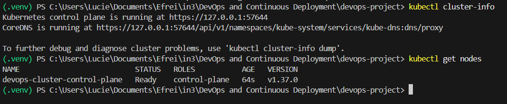
### 1.3 Create three namespaces: dev, staging, prod.
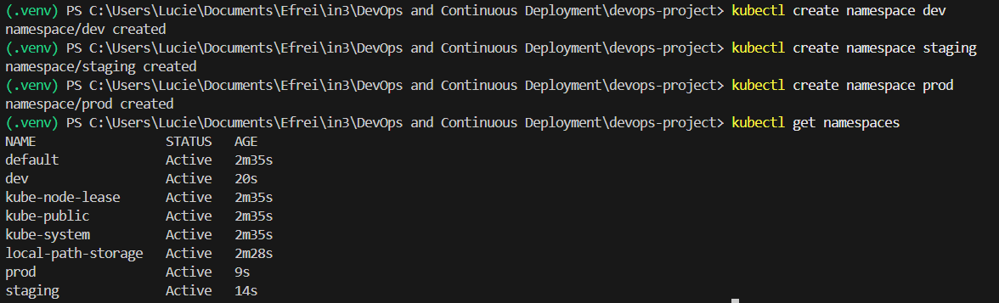

### Question 1. What is the role of a namespace? Does it provide strong security isolation by itself?
A namespace divides a Kubernetes cluster into different environments, such as dev, staging and prod. It helps organize resources and manage access. However, a namespace alone does not provide strong security isolation. We also need RBAC to control who can access resources.


## 2 Part 2: First Deployment

### In a new folder k8s/base/, create deployment.yaml and service.yaml for your image from Session 1 (3 replicas, port 3000).

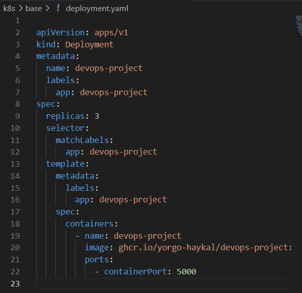
### 2.1 Apply the manifests in the dev namespace.
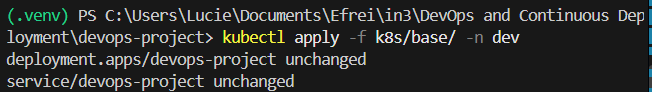
the first time I have created in sted of unchanged because Kubernetes just created the resource and now The resource exists
### 2.2 Check pods, deployment and service.

### 2.3 Reach the application with kubectl port-forward.

### 2.4 Delete one pod manually and observe what happens.
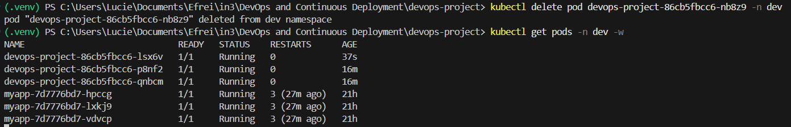
### 2.5 Scale to 5 replicas, then back to 3.
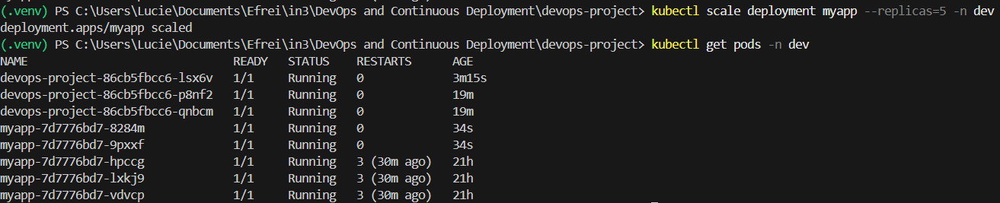

### Question 2. Why does Kubernetes recreate the deleted pod? Which component is responsible?
Kubernetes recreates the deleted Pod to maintain the desired number of replicas defined in the Deployment. The ReplicaSet is responsible for creating a new Pod when one is deleted.
The Deployment manages the ReplicaSet to make sure the application has the correct number of Pods.


## 3 Part 3: Probes, Resources and Configuration

### 3.1 Add a readinessProbe and a livenessProbe on /health.
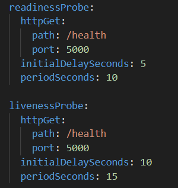
### 3.2 Add resource requests and limits.
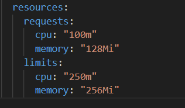
### 3.3 Create a ConfigMap with APP_ENV and inject it as an environment variable.
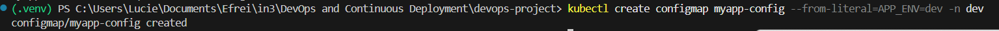
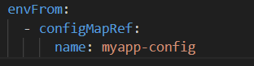
### 3.4 Create a Secret with a fake API key and mount it as an environment variable.
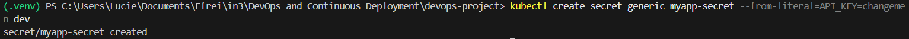
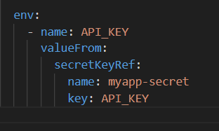
### 3.5 Break the probe path on purpose and observe pod behavior with kubectl describe.
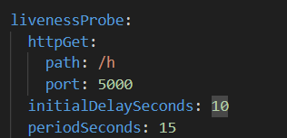
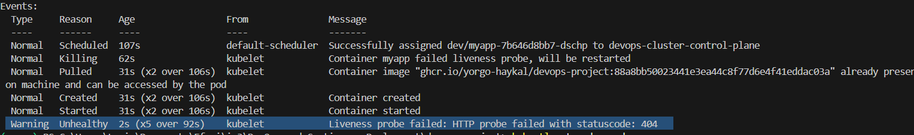

### Question 3. What is the difference between a readiness and a liveness probe? What happens to traffic when readiness fails?
A readiness probe checks if the application is ready to receive traffic. A liveness probe checks if the application is working correctly. If readiness fails, the Pod stops receiving traffic.
### Question 4. Is a Kubernetes Secret encrypted by default? How would you improve this?
No, Kubernetes Secrets are not encrypted by default. They are encoded in Base64. We can improve security by enabling encryption and using RBAC to control access.


## 4 Part 4: Multi-environment with Kustomize

### Organize the manifests as base + overlays, simulating three deployment targets (for example dev, staging, prod, standing for on-prem, cloud A, cloud B).

### 4.1 Write the base kustomization.yaml and the three overlays (different replicas, namespace and labels per environment).
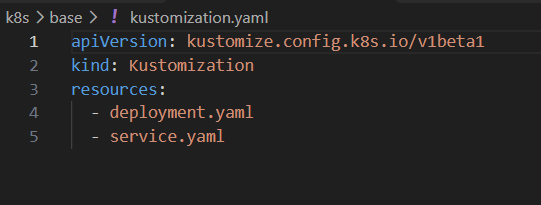

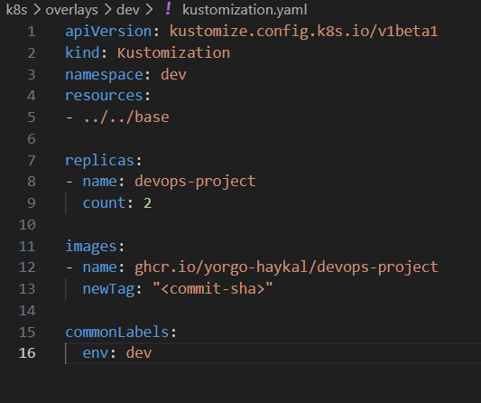
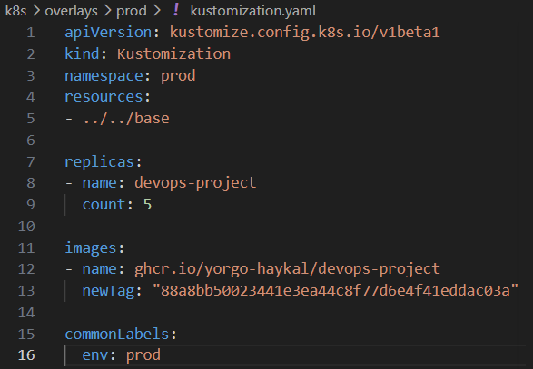
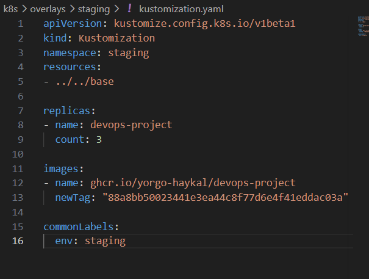
### 4.2 Preview the rendered output with kubectl kustomize.
```bash
kubectl kustomize k8s/overlays/dev
kubectl kustomize k8s/overlays/staging
kubectl kustomize k8s/overlays/prod
```

### 4.3 Deploy each overlay to its namespace.
```bash
kubectl apply -k k8s/overlays/dev
kubectl apply -k k8s/overlays/staging
kubectl apply -k k8s/overlays/prod
```
```bash
NAMESPACE            NAME                     READY   UP-TO-DATE 
dev                  devops-project           2/2     2            
prod                 devops-project           5/5     5            
staging              devops-project           3/3     3            
``` 
### 4.4 Verify the differences between environments.
```bash
kubectl kustomize pk je 8s/overlays/dev
kubectl kustomize k8s/overlays/staging
kubectl kustomize k8s/overlays/prod
```
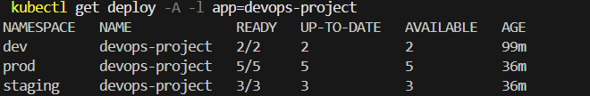

### Question 5. How does this pattern help with hybrid/multi-cloud deployments? What would differ between a real on-prem cluster and a cloud cluster?
Kustomize allows us to use the same base configuration in different environments. Only the overlays change. In a real on-prem cluster and a cloud cluster, the infrastructure and storage settings may be different, but the application configuration can stay mostly the same.


## 5 Part 5: Rolling Update and Rollback

### 5.2 Watch the rollout and verify there is no downtime.
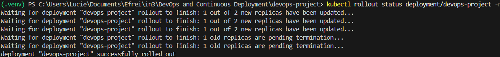
### 5.3 Deploy a broken image tag on purpose and observe the failed rollout.
newTag: "broken"
```bash
kubectl rollout status deployment/devops-project -n dev --timeout=30s
Waiting for deployment "devops-project" rollout to finish: 1 out of 2 new replicas have been updated...
error: timed out waiting for the condition
```
### 5.4 Roll back and check the revision history.
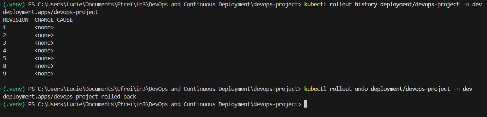

### Question 6. Why did the broken rollout not take down the application?
The broken rollout did not take down the application because Kubernetes kept the old working pods running until the new pods were ready


## 6 Part 6: Audit and Traceability

### 6.1 Add annotations to the Deployment: commit SHA, pipeline run URL, owner, ticket reference.
```bash
kubectl annotate deployment devops-project -n prod git-commit="88a8bb50023441e3ea44c8f77d6e4f41eddac03a" owner="team-a" ticket="OPS-123"
deployment.apps/devops-project annotated
```
### 6.3 Create a read-only Role and RoleBinding for a “viewer” service account and test what it can and cannot do.
```bash
kubectl create serviceaccount viewer -n dev
kubectl create role pod-reader --verb=get,list,watch --resource=pods -n dev
kubectl create rolebinding viewer-binding --role=pod-reader --serviceaccount=dev:viewer -n dev
```
```bash
 kubectl auth can-i delete pods -n dev --as=system:serviceaccount:dev:viewer
no
kubectl auth can-i list pods -n dev --as=system:serviceaccount:dev:viewer
yes
```

### Question 7. Starting from a pod running in production, how can you find the commit, the reviewer and the pipeline run that produced it?
We can use kubectl describe to find the image tag and annotations. The commit SHA and pipeline URL help us find the commit, reviewer and GitHub Actions run
### Question 8. Why is manual kubectl edit in production a traceability risk?
Because manual changes are not saved in Git. It is difficult to know who made the changes, why they were made and when


