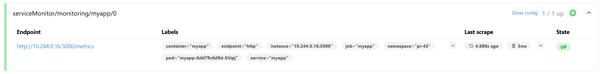
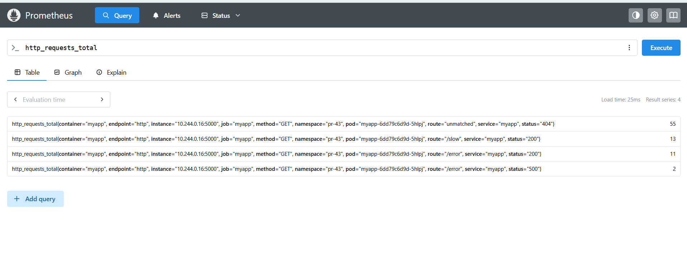
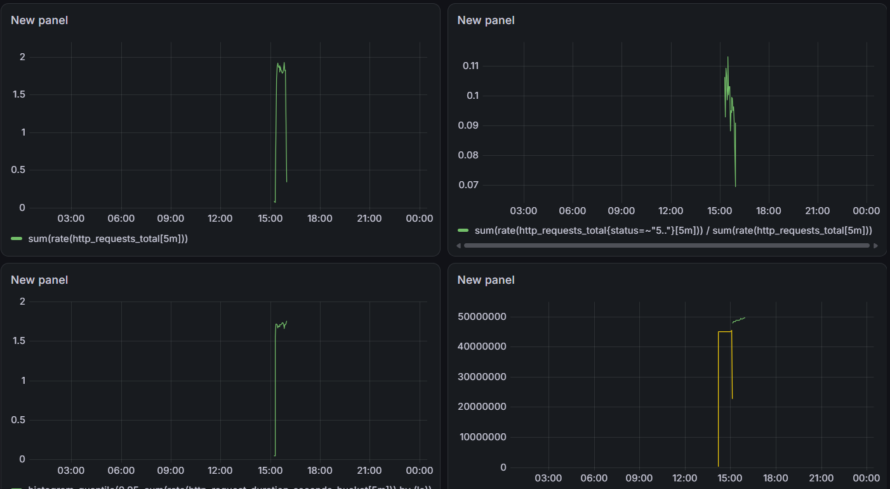

# DevOps Lab Session 4: Observability, Alerting and Incident Response

## Part 1: Instrument the Application

### 1.3 Run locally, call the endpoints, then check curl localhost:3000/metrics.
```bash
Invoke-WebRequest http://localhost:5000/health
Invoke-WebRequest http://localhost:5000/slow
Invoke-WebRequest http://localhost:5000/error

StatusCode        : 200
StatusDescription : OK
[...]

StatusCode        : 200
StatusDescription : OK
[...]

StatusCode        : 200
StatusDescription : OK

```
```bash
curl.exe http://localhost:5000/metrics
[...]
# HELP http_requests_total Total HTTP requests
# TYPE http_requests_total counter
http_requests_total{method="GET",route="/slow",status="200"} 3.0
http_requests_total{method="GET",route="/error",status="500"} 21.0
http_requests_total{method="GET",route="/error",status="200"} 40.0
http_requests_total{method="GET",route="/health",status="200"} 1.0
http_requests_total{method="GET",route="/metrics",status="200"} 1.0
[...]
# HELP http_request_duration_seconds HTTP request duration in seconds
# TYPE http_request_duration_seconds histogram
http_request_duration_seconds_count{method="GET",route="/slow"} 3.0
http_request_duration_seconds_sum{method="GET",route="/slow"} 3.27635
```

### 1.4 Build, tag with the commit SHA and push through your Session 1 pipeline.


### Question 1. Why is it a problem to use a user ID or a full URL containing IDs as a metric label?
User IDs create too many metrics in Prometheus. This uses more memory and makes it slower.

### Question 2. Why log to stdout in JSON rather than to a file in plain text?
stdout allows Docker to collect logs easily. JSON makes logs easier to read and understand.


## Part 2: Deploy the Monitoring Stack

### 2.1 Retrieve the Grafana admin password from the Kubernetes secret monitoring-grafana (decode the base64 value).
```bash
kubectl get secret monitoring-grafana -n monitoring -o jsonpath="{.data.admin-password}"
VHQxNEQwT29Pa0h2Q2xRdVl1TTNQbVRXdG9XZzhvRmRaa0JjZ2VWTA==

[Text.Encoding]::UTF8.GetString([Convert]::FromBase64String ("VHQxNEQwT29Pa0h2Q2xRdVl1TTNQbVRXdG9XZzhvRmRaa0JjZ2VWTA=="))                   
Tt14D0OoOkHvClQuYuM3PmTWtoWg8oFdZkBcgeVL

```
### 2.2 Open Grafana and browse the pre-installed Kubernetes dashboards.


### 2.3 Open the Prometheus UI and check the Targets page.


## Part 3: Scrape Your Application

### 3.2 Confirm that the target appears as UP in Prometheus.


### 3.3 Generate traffic with a loop and query http_requests_total in the Prometheus UI.



### Question 3. The target does not appear. List three things you would check.
Check the Service labels.
Check that the port is named `http`.
Check the ServiceMonitor settings.


## Part 4: PromQL and Dashboard

### 4.1 Write PromQL queries for each golden signal:
• Traffic: requests per second
• Errors: ratio of HTTP 5xx responses
• Latency: 95th percentile duration
• Saturation: CPU or memory usage of the pods

```bash
sum(rate(http_requests_total[5m]))
1.792535435126521
```
```bash
sum(rate(http_requests_total{status=~"5.."}[5m]))
/ sum(rate(http_requests_total[5m]))
0.10357815442561205
```
```bash
histogram_quantile(0.95,
sum(rate(http_request_duration_seconds_bucket[5m])) by (le))
1.7097826086956518
```
```bash
sum(container_memory_working_set_bytes{namespace="pr-43"}) by (pod)
48979968
```

### 4.2 Create a Grafana dashboard with one panel per signal.


### Question 4. Why is the 95th percentile more informative than the average latency?
the average shows the general response time, while the 95th percentile shows how slow the experience can be for most users.


## Part 5: Alerting

### 5.1 Apply the rule and verify it in the Prometheus Alerts page.


### 5.2 Increase the error rate (call /error heavily) until the alert goes to FIRING.


### Question 5. What is alert fatigue and how do the for: clause and severity labels help?
Alert fatigue happens when teams receive too many alerts and start ignoring them. The for: 2m avoids temporary alerts, and severity labels show how important an alert is.


## Part 6: Incident Simulation and Postmortem

### Question 6. Why mitigate before finding the root cause?
Mitigation reduces the impact on users while the team investigates the root cause.


### Question 7. Why must a postmortem be blameless? Give an example of a blameless rewording of “Alex deployed a bad version”.
A blameless postmortem helps the team learn without blaming people. Example: “The deployed version caused application errors.”


### Question 8. Propose two concrete changes to the pipeline from Sessions 1 to 3 that would have prevented or limited this incident (for example, canary release or smoke tests).
Add smoke tests before deployment to detect errors early.
Use canary releases to test the new version with a small number of users first.


