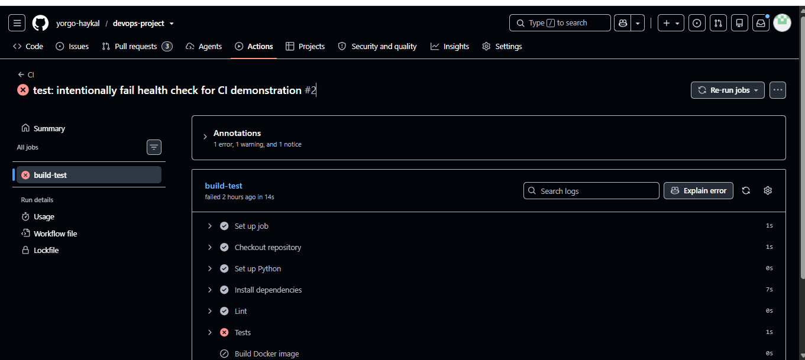

# devops-project

Minimal Flask API for the DevOps continuous deployment course.

## Team members 
Koffi Jean-Luc Junior ADJIEY 
Yorgo HAYKAL 
Léanna SUISSA
Lucie MOREAU 

## Endpoints

| Method | Path      | Response |
|--------|-----------|----------|
| GET    | `/health` | `OK` (200) |

## Run locally

```bash
python -m venv .venv
source .venv/bin/activate   # Windows: .venv\Scripts\activate
pip install -r requirements.txt
python app.py
curl http://localhost:5000/health
```

## Branch protection

- `main` is protected: all changes go through a Pull Request, which require an approving review and successful automated checks before merging.

- `build-test` job is configured as a required status check.


## Docker Containerization

The application is packaged as a Docker image using a lightweight Python base image.

The Dockerfile uses `python:3.12-slim`, installs the application dependencies, creates a non-root user and exposes port `5000`.

A `.dockerignore` file excludes unnecessary development files from the Docker build context.

### Build the Docker Image

```bash
docker build -t myapp:0.1 .
```

### Run the Container

```bash
docker run -d -p 5000:5000 --name myapp myapp:0.1
```

### Verify the Endpoint

```bash
curl http://localhost:5000/health
```

Expected output:

```text
OK
```

### Inspect the Container

View the application logs:

```bash
docker logs myapp
```

Open a shell inside the container:

```bash
docker exec -it myapp sh
```

Verify that the container runs as a non-root user:

```bash
whoami
```

Expected output:

```text
appuser
```

### Docker Image Size Comparison

Two Docker images were built and compared.

| Base image | Disk usage |
|---|---:|
| `python:3.12-slim` | 198 MB |
| `python:3.12` | 1.62 GB |

The slim-based image uses approximately **87.8% less disk space** than the full Python-based image.

This demonstrates the benefits of choosing a lightweight base image.


## Continuous Integration Pipeline

The CI pipeline is implemented using GitHub Actions.

**Workflow:** [`.github/workflows/ci.yml`](https://github.com/yorgo-haykal/devops-project/blob/main/.github/workflows/ci.yml)

### CI Pipeline Steps

The `build-test` job performs the following operations:

1. Checks out the repository.
2. Sets up Python 3.12.
3. Installs application and development dependencies.
4. Runs Ruff linting.
5. Executes automated tests using Pytest.
6. Builds the Docker image.

The workflow runs automatically on configured push and Pull Request events.

### Automated Health Endpoint Test

The application includes an automated test that verifies:

- The `/health` endpoint responds with HTTP status code `200`.
- The response body contains `OK`.

### Failed Pipeline Demonstration

To demonstrate CI failure detection, the expected HTTP status code was deliberately changed from `200` to `404`.

Since the application returned `200`, the test failed.

GitHub Actions reported a failed pipeline, demonstrating that the CI workflow detects incorrect code.



### Successful Pipeline Demonstration

After restoring the correct expected status code (`200`), the automated tests passed and the CI pipeline completed successfully.

The final pipeline executed on `main` also completed successfully, including the image publication job.


## Continuous Delivery — Docker Image Publication

After successful validation, the `publish` job automatically publishes the Docker image to GitHub Container Registry.

The publication job:

1. Waits for `build-test` to succeed.
2. Runs only after a push to `main`.
3. Authenticates to GHCR using the automatically provided `GITHUB_TOKEN`.
4. Builds and publishes the Docker image.
5. Tags the image using the Git commit SHA.

### Published Docker Image

**Registry:** GitHub Container Registry

**Package:** [devops-project on GHCR](https://github.com/yorgo-haykal/devops-project/pkgs/container/devops-project)

**Image:**

```text
ghcr.io/yorgo-haykal/devops-project:e2aafa2142832bec55000f5885e0289a58476e97
```

### Pull the Published Image

```bash
docker pull ghcr.io/yorgo-haykal/devops-project:e2aafa2142832bec55000f5885e0289a58476e97
```

### Security

No passwords or authentication tokens are stored in plain text in the repository.

The pipeline uses GitHub Actions' automatically generated `GITHUB_TOKEN` to authenticate securely to GHCR.

The publication job is granted the `packages: write` permission required to publish container images.

## CI/CD Traceability

The CI/CD workflow provides traceability between the source code, the pipeline execution and the published image.

### Source Commit

**Branch:** `main`

**Commit SHA:**

```text
e2aafa2142832bec55000f5885e0289a58476e97
```

**Pull Request:** [PR #4](https://github.com/yorgo-haykal/devops-project/pull/4)

### Pipeline Execution

After the Pull Request was merged, GitHub Actions executed the workflow on `main`.

| Job | Status | Duration |
|---|---|---|
| `build-test` | Success | 26 seconds |
| `publish` | Success | 34 seconds |

**Total workflow duration:** 1 minute 7 seconds.

### Published Artifact

The Docker image was successfully published to GHCR with a tag matching the source commit SHA.

**Traceability chain:**

`Source commit → build-test → publish → GHCR image`

Using the commit SHA makes it possible to identify the exact source code version associated with the published Docker image.


## Questions & Answers

### Question 1: Why forbid direct pushes to main?

Direct pushes to `main` are forbidden to protect the stability of the project. Pull Requests allow developers to review changes, run automated tests and detect potential problems before merging code into the main branch.

### Question 2: What is the difference between an image and a container?

A Docker image is a read-only template containing the application, its dependencies and the environment required to run it.

A Docker container is a running instance of an image. Multiple containers can be created from the same image.

### Question 3: Compare the size of your image with a non-slim base image. What do you observe?

We built two Docker images using different Python base images.

| Base image | Disk usage |
|---|---:|
| `python:3.12-slim` | 198 MB |
| `python:3.12` | 1.62 GB |

The slim image is approximately 87.8% smaller.

This is because slim images exclude many unnecessary system packages and tools. Using slim images reduces storage requirements and can improve image transfer times.

### Question 4: Why tag the image with the commit SHA rather than latest?

Using the commit SHA provides a unique identifier that links the Docker image to a specific version of the source code.

It improves traceability and reproducibility and makes it easier to identify or roll back to a specific version.

The `latest` tag is mutable and does not reliably identify a specific version.

### Question 5: What does "fail fast" mean in a pipeline?

Fail fast means stopping the pipeline as soon as a critical step fails, instead of continuing with unnecessary operations.

For example, when our automated health endpoint test failed, GitHub Actions stopped the job before building the Docker image.

This saves resources and prevents invalid code from progressing through the pipeline.


## Lab Deliverables

| Required deliverable | Evidence |
|---|---|
| GitHub repository with Dockerfile, CI workflow and tests | [GitHub Repository](https://github.com/yorgo-haykal/devops-project) |
| Screenshot of a failing pipeline | [Failed Pipeline](screenshots/pipeline-failed.png) |
| Screenshot of a successful pipeline | [Successful Pipeline](screenshots/pipeline-success.png) |
| Published Docker image | [GHCR Package](https://github.com/yorgo-haykal/devops-project/pkgs/container/devops-project) |
| Answers to questions 1–5 | "Questions & Answers" Section of this README |

## Session 2: Kubernetes Multi-environment Deployment

### Cluster Resources per Namespace

```
=== DEV ===
NAME                                  READY   STATUS    RESTARTS   AGE
pod/devops-project-66d4fb6c8f-hzl96   1/1     Running   0          67m
pod/devops-project-66d4fb6c8f-mpgg4   1/1     Running   0          67m

NAME                     TYPE        CLUSTER-IP      EXTERNAL-IP   PORT(S)   AGE
service/devops-project   ClusterIP   10.96.173.212   <none>        80/TCP    109m

NAME                             READY   UP-TO-DATE   AVAILABLE   AGE
deployment.apps/devops-project   2/2     2            2           74m

NAME                                        DESIRED   CURRENT   READY   AGE
replicaset.apps/devops-project-5f986cb666   0         0         0       70m
replicaset.apps/devops-project-66d4fb6c8f   2         2         2       74m

=== STAGING ===
NAME                                  READY   STATUS    RESTARTS   AGE
pod/devops-project-7747d869b9-lsb4z   1/1     Running   0          75m
pod/devops-project-7747d869b9-w8g7z   1/1     Running   0          75m
pod/devops-project-7747d869b9-xxkzq   1/1     Running   0          75m

NAME                     TYPE        CLUSTER-IP      EXTERNAL-IP   PORT(S)   AGE
service/devops-project   ClusterIP   10.96.189.255   <none>        80/TCP    75m

NAME                             READY   UP-TO-DATE   AVAILABLE   AGE
deployment.apps/devops-project   3/3     3            3           75m

NAME                                        DESIRED   CURRENT   READY   AGE
replicaset.apps/devops-project-7747d869b9   3         3         3       75m

=== PROD ===
NAME                                  READY   STATUS    RESTARTS   AGE
pod/devops-project-66d4fb6c8f-2kbrj   1/1     Running   0          73m
pod/devops-project-66d4fb6c8f-7nnhf   1/1     Running   0          73m
pod/devops-project-66d4fb6c8f-8788l   1/1     Running   0          73m
pod/devops-project-66d4fb6c8f-g7ffg   1/1     Running   0          73m
pod/devops-project-66d4fb6c8f-zmhgk   1/1     Running   0          73m

NAME                     TYPE        CLUSTER-IP     EXTERNAL-IP   PORT(S)   AGE
service/devops-project   ClusterIP   10.96.50.184   <none>        80/TCP    73m

NAME                             READY   UP-TO-DATE   AVAILABLE   AGE
deployment.apps/devops-project   5/5     5            5           73m

NAME                                        DESIRED   CURRENT   READY   AGE
replicaset.apps/devops-project-66d4fb6c8f   5         5         5       73m
```

### Rolling Update and Rollback

**Rolling update to v2:**

```
$ kubectl set image deployment/devops-project devops-project=devops-project:v2 -n dev
deployment.apps/devops-project image updated

$ kubectl rollout status deployment/devops-project -n dev
Waiting for deployment "devops-project" rollout to finish: 1 out of 2 new replicas have been updated...
Waiting for deployment "devops-project" rollout to finish: 1 old replicas are pending termination...
deployment "devops-project" successfully rolled out
```

**Rollout history after update:**

```
$ kubectl rollout history deployment/devops-project -n dev
REVISION  CHANGE-CAUSE
3         <none>
4         Updated to v2
```

**Rollback to previous version:**

```
$ kubectl rollout undo deployment/devops-project -n dev
deployment.apps/devops-project rolled back

$ kubectl rollout status deployment/devops-project -n dev
Waiting for deployment "devops-project" rollout to finish: 1 out of 2 new replicas have been updated...
Waiting for deployment "devops-project" rollout to finish: 1 old replicas are pending termination...
deployment "devops-project" successfully rolled out
```

**Rollout history after rollback:**

```
$ kubectl rollout history deployment/devops-project -n dev
REVISION  CHANGE-CAUSE
4         Updated to v2
5         <none>
```

Revision 5 is the rollback to the original image. The application was available throughout both operations with no downtime.

### RBAC: Read-only Viewer Role

**Role** (allows get, list, watch on pods only):

```yaml
apiVersion: rbac.authorization.k8s.io/v1
kind: Role
metadata:
  name: pod-reader
  namespace: dev
rules:
- apiGroups: [""]
  resources: ["pods"]
  verbs: ["get", "list", "watch"]
```

**RoleBinding** (binds the Role to the `viewer` ServiceAccount):

```yaml
apiVersion: rbac.authorization.k8s.io/v1
kind: RoleBinding
metadata:
  name: viewer-binding
  namespace: dev
roleRef:
  apiGroup: rbac.authorization.k8s.io
  kind: Role
  name: pod-reader
subjects:
- kind: ServiceAccount
  name: viewer
  namespace: dev
```

**`auth can-i` results:**

```
$ kubectl auth can-i list pods -n dev --as=system:serviceaccount:dev:viewer
yes
$ kubectl auth can-i delete pods -n dev --as=system:serviceaccount:dev:viewer
no
```

The `viewer` service account can read pods but cannot delete them or create deployments, confirming the read-only RBAC policy works as expected.
