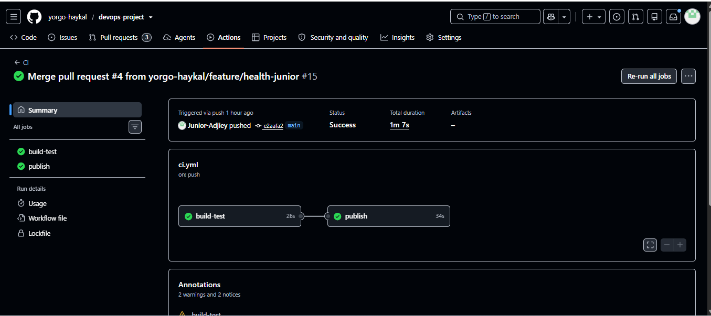

# **DevOps Lab**
Minimal Flask API for the DevOps continuous deployment course.

## Team members 
Koffi Jean-Luc Junior ADJIEY 

Yorgo HAYKAL 

Léanna SUISSA

Lucie MOREAU 

## Note on AI usage 
How AI was used :

AI was used as an assistant:
    - Understanding concepts. It helped explain ideas such as Terraform drift detection, why state files stay out of Git, separate state per environment versus workspaces, and ephemeral preview environments.
    - Writing and structuring documentation. It helped draft and tidy the lab answers (ANSWERS/*.md) in clear English,based on the results we actually obtained in the labs.
    - Code and config support. It helped with the Dockerfiles, Kubernetes manifests and Terraform modules: suggesting structure, explaining errors and proposing fixes.
    - Debugging. It was used to interpret terraform plan/apply output and container errors.

Human responsibility.
    - We ran every command ourselves and kept the evidence (evidence/, screenshots/).
    - We checked AI suggestions against the real behaviour of the infrastructure. For example, we deleted the tf-web conntainer by hand and watched Terraform detect the drift.
    - We stayed responsible for security choices. No secrets or state files were committed, and *.tfstate is in .gitignore.

Limits and good practice.
  - AI output can be wrong or out of date, so it was tested before being kept.
  - Nothing sensitive (credentials, tokens, state) was shared with AI tools.
  - AI was a productivity and learning aid. The design decisions and the final understanding are ours.

Summary. AI sped up learning, writing and troubleshooting. The results were validated by hands-on execution.

## Endpoints

| Method | Path      | Response |
|--------|-----------|----------|
| GET    | `/health` | `OK` (200) |
| GET    | `/metrics` | Prometheus metrics (text exposition format) |
| GET    | `/slow`   | Responds after a random delay of up to 2 s |
| GET    | `/error`  | Returns HTTP 500 about 30% of the time |

## Run locally

```bash
python -m venv .venv
source .venv/bin/activate   # Windows: .venv\Scripts\activate
pip install -r requirements.txt
python app.py
curl http://localhost:5000/health
```

## Branch protection

- `main` is protected: all changes go through a Pull Request, which require an approving review and successful automated checks before merging.

- `build-test` job is configured as a required status check.

## Table of Contents

- [Lab 1 — Git, CI/CD and Docker](#lab-1--git-cicd-and-docker)
- [Lab 2 — Kubernetes, Multi-environment Deployment and Audit](#lab-2--kubernetes-multi-environment-deployment-and-audit)
- [Lab 3 — Terraform, Environments and Ephemeral Previews](#lab-3--terraform-environments-and-ephemeral-previews)
- [Lab 4 — Observability, Alerting and Incident Response](#lab-4--observability-alerting-and-incident-response)

## Lab 1 — Git, CI/CD and Docker
### Docker Containerization

The application is packaged as a Docker image using a lightweight Python base image.

The Dockerfile uses `python:3.12-slim`, installs the application dependencies, creates a non-root user and exposes port `5000`.

A `.dockerignore` file excludes unnecessary development files from the Docker build context.

#### Build the Docker Image

```bash
docker build -t myapp:0.1 .
```

#### Run the Container

```bash
docker run -d -p 5000:5000 --name myapp myapp:0.1
```

#### Verify the Endpoint

```bash
curl http://localhost:5000/health
```

Expected output:

```text
OK
```

#### Inspect the Container

View the application logs:

```bash
docker logs myapp
```

Open a shell inside the container:

```bash
docker exec -it myapp sh
```

Verify that the container runs as a non-root user:

```bash
whoami
```

Expected output:

```text
appuser
```

#### Docker Image Size Comparison

Two Docker images were built and compared.

| Base image | Disk usage |
|---|---:|
| `python:3.12-slim` | 198 MB |
| `python:3.12` | 1.62 GB |

The slim-based image uses approximately **87.8% less disk space** than the full Python-based image.

This demonstrates the benefits of choosing a lightweight base image.


### Continuous Integration Pipeline

The CI pipeline is implemented using GitHub Actions.

**Workflow:** [`.github/workflows/ci.yml`](https://github.com/yorgo-haykal/devops-project/blob/main/.github/workflows/ci.yml)

#### CI Pipeline Steps

The `build-test` job performs the following operations:

1. Checks out the repository.
2. Sets up Python 3.12.
3. Installs application and development dependencies.
4. Runs Ruff linting.
5. Executes automated tests using Pytest.
6. Builds the Docker image.

The workflow runs automatically on configured push and Pull Request events.

#### Automated Health Endpoint Test

The application includes an automated test that verifies:

- The `/health` endpoint responds with HTTP status code `200`.
- The response body contains `OK`.

#### Failed Pipeline Demonstration

To demonstrate CI failure detection, the expected HTTP status code was deliberately changed from `200` to `404`.

Since the application returned `200`, the test failed.

GitHub Actions reported a failed pipeline, demonstrating that the CI workflow detects incorrect code.


#### Successful Pipeline Demonstration

After restoring the correct expected status code (`200`), the automated tests passed and the CI pipeline completed successfully.

The final pipeline executed on `main` also completed successfully, including the image publication job.




### Continuous Delivery — Docker Image Publication

After successful validation, the `publish` job automatically publishes the Docker image to GitHub Container Registry.

The publication job:

1. Waits for `build-test` to succeed.
2. Runs only after a push to `main`.
3. Authenticates to GHCR using the automatically provided `GITHUB_TOKEN`.
4. Builds and publishes the Docker image.
5. Tags the image using the Git commit SHA.

#### Published Docker Image

**Registry:** GitHub Container Registry

**Package:** [devops-project on GHCR](https://github.com/yorgo-haykal/devops-project/pkgs/container/devops-project)

**Image:**

```text
ghcr.io/yorgo-haykal/devops-project:e2aafa2142832bec55000f5885e0289a58476e97
```

#### Pull the Published Image

```bash
docker pull ghcr.io/yorgo-haykal/devops-project:e2aafa2142832bec55000f5885e0289a58476e97
```

#### Security

No passwords or authentication tokens are stored in plain text in the repository.

The pipeline uses GitHub Actions' automatically generated `GITHUB_TOKEN` to authenticate securely to GHCR.

The publication job is granted the `packages: write` permission required to publish container images.

### CI/CD Traceability

The CI/CD workflow provides traceability between the source code, the pipeline execution and the published image.

#### Source Commit

**Branch:** `main`

**Commit SHA:**

```text
e2aafa2142832bec55000f5885e0289a58476e97
```

**Pull Request:** [PR #4](https://github.com/yorgo-haykal/devops-project/pull/4)

#### Pipeline Execution

After the Pull Request was merged, GitHub Actions executed the workflow on `main`.

| Job | Status | Duration |
|---|---|---|
| `build-test` | Success | 26 seconds |
| `publish` | Success | 34 seconds |

**Total workflow duration:** 1 minute 7 seconds.

#### Published Artifact

The Docker image was successfully published to GHCR with a tag matching the source commit SHA.

**Traceability chain:**

`Source commit → build-test → publish → GHCR image`

Using the commit SHA makes it possible to identify the exact source code version associated with the published Docker image.

## Lab 1 Deliverables

| Required deliverable | Evidence |
|---|---|
| GitHub repository with Dockerfile, CI workflow and tests | [GitHub Repository](https://github.com/yorgo-haykal/devops-project) |
| Screenshot of a failing pipeline | [Failed Pipeline](screenshots/lab1/part3/3.2-pipeline-failed.png) |
| Screenshot of a successful pipeline | [Successful Pipeline](screenshots/lab1/part3/3.3-pipeline-success.png) |
| Published Docker image | [GHCR Package](https://github.com/yorgo-haykal/devops-project/pkgs/container/devops-project) |
| Answers to questions 1–5 | "Questions & Answers" Section of this README |


## Lab 2 — Kubernetes, Multi-environment Deployment and Audit

### Kubernetes Cluster Setup

A local Kubernetes cluster was created using Kind (Kubernetes in Docker).

The cluster is named `devops-lab` and contains a control-plane node.

Three namespaces were created to isolate the application environments:

- `dev`
- `staging`
- `prod`

### Kubernetes Deployment and Service

The Flask application was deployed using Kubernetes manifests.

The Deployment configuration defines:

- A container image published to GitHub Container Registry (GHCR).
- Three application replicas by default.
- Container port `5000`.
- Readiness and liveness probes using `/health`.

A ClusterIP Service exposes the application internally on port `80` and forwards requests to container port `5000`.

The application was successfully tested using `kubectl port-forward`, returning `OK` from the `/health` endpoint.

### Multi-Environment Configuration with Kustomize

Kustomize was used to manage different environments without duplicating the entire Kubernetes configuration.

The project contains a common base and three environment overlays:

- `k8s/base/`
- `k8s/overlays/dev/`
- `k8s/overlays/staging/`
- `k8s/overlays/prod/`

The following deployments were successfully verified:

| Environment | Replicas | Status |
|---|---:|---|
| DEV | 3 | Available |
| STAGING | 3 | Available |
| PROD | 5 | Available |

Each environment can be configured independently while sharing the same base manifests.

### Kubernetes Self-Healing and Scaling

Kubernetes self-healing was tested by manually deleting an application Pod.

The ReplicaSet automatically created a replacement Pod to maintain the desired number of replicas.

Horizontal scaling was also tested by increasing the DEV Deployment from three to five replicas, then restoring it to three.

These experiments demonstrated Kubernetes' reconciliation mechanism.

### Readiness and Liveness Probes

The application uses the `/health` endpoint for health monitoring.

A readiness probe determines whether a Pod is ready to receive traffic.

A liveness probe determines whether a container should be restarted because it is unhealthy.

A deliberately incorrect readiness path (`/wrong-health`) was tested to demonstrate how Kubernetes detects an unready application.

The correct configuration was restored afterward.

### Rolling Updates and Rollbacks

Kubernetes rolling updates were tested using both invalid and valid container images.

An invalid image tag caused an `ErrImagePull` error in a new Pod, while the existing healthy Pods remained available.

The Deployment was then restored using:

```bash
kubectl rollout undo deployment/myapp -n dev
```

A successful rolling update was also performed using a valid GHCR image.

This demonstrated how Kubernetes can progressively update an application and recover from a failed deployment.

### Configuration and Secrets

Kubernetes ConfigMaps and Secrets were used to separate application configuration from container images.

ConfigMaps store non-sensitive configuration values.

Secrets provide a dedicated mechanism for managing sensitive values, although Base64 encoding alone does not provide encryption.

### Role-Based Access Control (RBAC)

Kubernetes RBAC was configured to restrict access to resources.

A dedicated ServiceAccount was associated with a Role and RoleBinding in the DEV namespace.

The permissions were tested to verify that:

- Listing Pods in DEV was authorized.
- Deleting Pods in DEV was denied.
- Listing Pods in PROD was denied.

This demonstrated the principle of least privilege.

### Audit and Traceability

Kubernetes rollout history, events, deployment information, and RBAC test results were collected as evidence.

The project includes deployment annotations and GitHub CI/CD information to support traceability between application versions and infrastructure changes.


## Lab 2 Deliverables

- Kubernetes manifests: `k8s/base/`
- Environment overlays: `k8s/overlays/`
- RBAC configuration: `k8s/rbac/`
- Deployment and rollback evidence: `evidence/lab2/`
- Answers to the eight lab questions: [`ANSWERS/2-ANSWERS.md`](ANSWERS/2-ANSWERS.md)


## Lab 3 — Terraform, Environments and Ephemeral Previews

### Infrastructure as Code

Terraform is used to provision and manage infrastructure through declarative configuration files.

The lab covers Docker resources, reusable modules, isolated environments, state management, Kubernetes preview environments, and CI security scanning.

### Terraform Project Structure

- `infra/quickstart/`: first Terraform configuration using Docker.
- `infra/modules/webapp/`: reusable Terraform module.
- `infra/envs/dev/`: development environment.
- `infra/envs/staging/`: staging environment.
- `infra/preview/`: ephemeral Kubernetes environment per Pull Request.
- `evidence/lab3/`: evidence of infrastructure deployments.

### Environment Isolation

Development and staging use the same reusable module with different variables and ports.

- DEV: `http://localhost:8083`
- STAGING: `http://localhost:8084`

Terraform state files are excluded from Git to avoid exposing sensitive infrastructure information.

### Ephemeral Preview Environments

Terraform provisions isolated Kubernetes namespaces for Pull Requests.

Two environments were successfully created:

- `pr-42`
- `pr-43`

Each environment used a separate Terraform state file.

The `pr-42` environment was destroyed without affecting `pr-43`.

The remaining preview environment was updated with security settings, resource limits, health probes, and a container image pinned to a SHA256 digest.

The `/health` endpoint was successfully tested after deployment.

### Terraform CI and Security Scanning

GitHub Actions executes three Terraform jobs:

1. Terraform Format and Validate
2. Terraform Security Scan using Checkov
3. Terraform Plan

The pipeline initially detected configuration and security issues. These were addressed through configuration changes, with two image-related Checkov checks explicitly skipped because Terraform variable validation enforces digest pinning.

All three jobs subsequently completed successfully.

## Lab 3 Evidence

- [Kubernetes namespaces](evidence/lab3/lab3-part4-4.4-namespaces.txt)
- [PR #43 deployment](evidence/lab3/lab3-part4-4.3-preview-pr43.txt)
- [PR #43 Terraform state resources](evidence/lab3/lab3-part4-4.3-preview-state.txt)
- [Answers to Lab 3 questions](ANSWERS/3-ANSWERS.md)
- [Terraform Pull Request #20](https://github.com/yorgo-haykal/devops-project/pull/20)

## Lab 4 — Observability, Alerting and Incident Response

### Part 1 — Instrument the Application

The Flask application exposes Prometheus metrics and writes structured logs:

- `GET /metrics` exposes `http_requests_total` (labels `method`, `route`, `status`) and `http_request_duration_seconds` (labels `method`, `route`), implemented with `prometheus-client`.
- The `route` label uses the Flask route template and not the real URL, which keeps the label cardinality bounded.
- Each request produces one JSON log line on stdout (`timestamp`, `level`, `method`, `path`, `status` and the duration).
- Two test endpoints were added: `/slow` (random delay up to 2 s) and `/error` (HTTP 500 about 30% of the time).
- The image was built and run locally with Docker before going through the CI pipeline.

### Part 2 — Deploy the Monitoring Stack

The `kube-prometheus-stack` Helm chart was installed in the `monitoring` namespace of the kind cluster (release name `monitoring`). It deploys Prometheus, Alertmanager, Grafana, the Prometheus operator, kube-state-metrics and node-exporter.

- Grafana is reached with `kubectl port-forward` on port 3001, and the `admin` password is read from the `monitoring-grafana` Kubernetes secret.
- Prometheus is reached with `kubectl port-forward` on port 9091.
- The pre-installed Kubernetes dashboards and the Prometheus targets were checked. Some control plane targets (for example `kube-controller-manager` and `etcd`) are `DOWN`, because kind does not expose their metrics endpoints to the cluster network.

### Lab 4 Evidence

- [Test endpoints: server logs and requests](evidence/lab4/lab4-part1-1.2.txt)
- [`/metrics` output](evidence/lab4/lab4-part1-1.3.txt)
- [Local Docker build and run](evidence/lab4/lab4-part1-1.4.txt)
- [Grafana login](screenshots/lab4/part2/2.2-graphana-connexion.png)
- [Pre-installed dashboards](screenshots/lab4/part2/2.3-browse.png)
- [Prometheus targets](screenshots/lab4/part2/2.4-target.png)
- [Prometheus targets in DOWN state](screenshots/lab4/part2/2.4-target-down.png)
- [Answers to Lab 4 questions](ANSWERS/4-ANSWERS.md)
