# DevOps Lab Session 1: Git, CI/CD and Docker

## 1 Part 1: Git Repository and Branching Workflow

### 1.3 Create a suitable .gitignore file (dependencies, environment files).
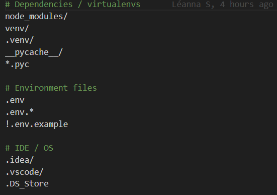
### 1.6 Create a branch feature/health, add a simple test, push it and open a Pull Request.
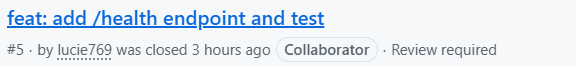

### Question 1. Why forbid direct pushes to main?
Direct pushes are forbidden because the main branch must be protected. Every change must be checked before going into main to avoid conflicts and problems in the main branch.


## 2 Part 2: Containerization

### 2.1 Write a Dockerfile for the application.
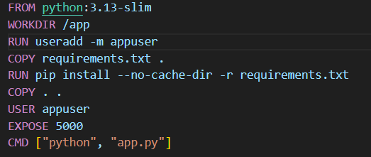
### 2.2 Add a .dockerignore file.
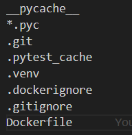
### 2.3 Build the image and run the container.
```bash
docker build -t myapp:0.1 . # Build the image
docker run -d -p 3000:5000 --name myapp myapp:0.1 #run the container
```
### 2.4 Check that the endpoint responds.
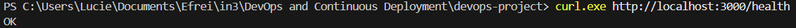
### 2.5 View the logs, then get a shell in the container with docker exec.
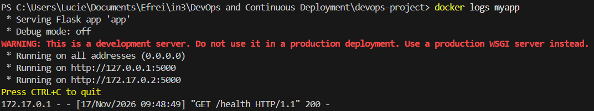

### Question 2. What is the difference between an image and a container?
The image: it is the file that contains everything needed to start the application
The container: it is the application running using this image
### Question 3. Compare the size of your image with a non-slim base image. What do you observe?
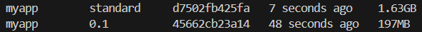
The standard image is much bigger (1.63 GB) than the Slim image (197 MB). The Slim image uses less space and is lighter.

### Bonus. Turn the Dockerfile into a multi-stage build and compare sizes.
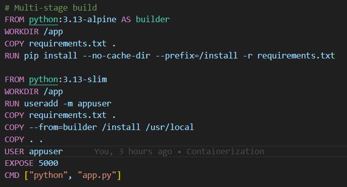


## 3 Part 3: CI Pipeline

### Create the file .github/workflows/ci.yml with the following steps: checkout, dependency installation, lint, tests, Docker image build.
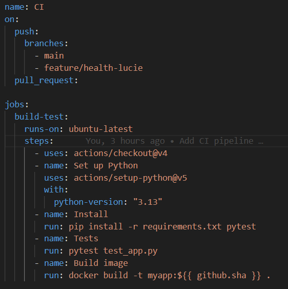
### 3.1 Push the workflow to your branch and watch the run in the Actions tab.
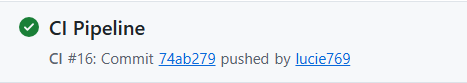
### 3.2 Deliberately break a test and observe that the Pull Request is blocked.
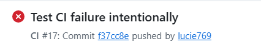
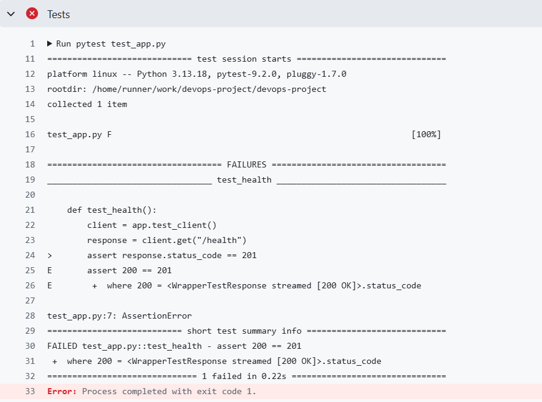
### 3.3 Fix it and verify that the pipeline goes green again.
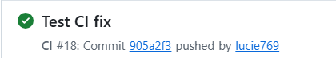

### Question 4. Why tag the image with the commit SHA rather than latest?
We use the commit SHA because it tells us exactly which version of the code is inside the Docker image. With `latest`, we don't know exactly which version we are using because it can change.
### Question 5. What does “fail fast” mean in a pipeline?
Fail fast means finding errors quickly. If a test fails, the pipeline stops before doing the next steps. This saves time.

